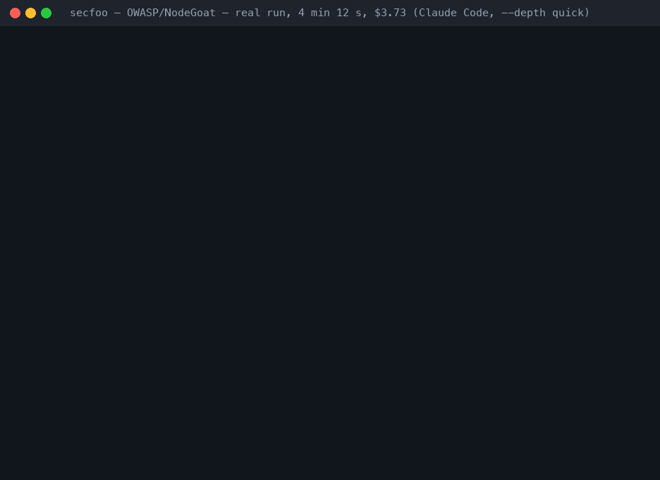

<p align="center">
  
</p>

# secfoo — AI security review CLI

<p align="center">
  <strong>Turn the coding agent you already have into a disciplined security reviewer.</strong><br>
  SAST, secret scanning, SCA, threat modeling and architecture review. Same checklist, same report shape, every run.
</p>

<p align="center">
  <a href="https://pypi.org/project/secfoo/"></a>
  <a href="https://pypi.org/project/secfoo/"></a>
  <a href="https://github.com/secfoo-com/secfoo/actions/workflows/ci.yml"></a>
  <a href="https://scorecard.dev/viewer/?uri=github.com/secfoo-com/secfoo"></a>
  <a href="https://github.com/secfoo-com/secfoo/blob/main/LICENSE"></a>
</p>

<p align="center">
  <a href="https://secfoo.com">Website</a> ·
  <a href="https://secfoo.com/docs/index.html#install">Getting started</a> ·
  <a href="https://secfoo.com/docs/cli.html">CLI</a> ·
  <a href="https://github.com/secfoo-com/secfoo/blob/main/docs/CI.md">CI guide</a> ·
  <a href="https://github.com/secfoo-com/secfoo/blob/main/examples/sample-output/nodegoat">Sample output</a>
</p>

```bash
uvx secfoo run --skill sast --skill secret-scanning --target https://github.com/OWASP/NodeGoat
```

That is the whole first run. No config file: secfoo picks the agent you
already have on `PATH` (Claude Code, Codex, Gemini CLI, Copilot, Cursor,
Antigravity, OpenCode, ...) or, if none is installed, uses the
`OPENAI_API_KEY` / `ANTHROPIC_API_KEY` / `GEMINI_API_KEY` already in your
shell. Pass `--agent` to choose. Keep it around with `pipx install secfoo`
or `pip install secfoo`; more channels under [Install](#install).

## What it found on OWASP NodeGoat

One real, unedited run against [OWASP/NodeGoat](https://github.com/OWASP/NodeGoat)
(Claude Code, `--depth quick`, 2026-11-14), both skills running concurrently:

| Skill | Critical | High | Medium | Low | Time | Cost |
|---|---|---|---|---|---|---|
| SAST — Static Code Analysis | 0 | 6 | 5 | 1 | 4 min 12 s | $2.34 |
| Secret Scanning — Code, Confluence & Docs | 0 | 3 | 2 | 1 | 2 min 15 s | $1.39 |

Among the Highs: `eval()` on a POST body (CWE-95), SSRF with the response
reflected as HTML (CWE-918), NoSQL injection through a `$where` string
(CWE-943), IDOR on `/allocations/:userId`, autoescaping disabled globally
(CWE-79), an RSA private key and the session-signing secret committed to the
repo. Every finding carries CWE, OWASP category, CVSS vector, location,
the vulnerable code and a fix. The full reports, the SARIF and the JSONL
export are in [examples/sample-output/nodegoat](https://github.com/secfoo-com/secfoo/blob/main/examples/sample-output/nodegoat).

## Put it in CI

Findings show up in GitHub's **Security** tab and as PR annotations; the job
fails on the severity you choose.

```yaml
# .github/workflows/secfoo.yml
permissions:
  contents: read
  security-events: write
steps:
  - uses: actions/checkout@v4
  - uses: secfoo-com/secfoo@main
    env:
      OPENAI_API_KEY: ${{ secrets.OPENAI_API_KEY }}   # or ANTHROPIC_API_KEY / GEMINI_API_KEY
    with:
      skills: sast,secret-scanning
      fail-on: high
      max-cost: "2.00"
```

- **GitHub Action** with SARIF upload, job summary and severity outputs: [docs/CI.md](https://github.com/secfoo-com/secfoo/blob/main/docs/CI.md#github-actions)
- **pre-commit**: `repo: https://github.com/secfoo-com/secfoo`, hooks `secfoo-secrets` and `secfoo` ([example](https://github.com/secfoo-com/secfoo/blob/main/examples/ci/pre-commit-config.yaml))
- **GitLab CI** job with SARIF artifact: [examples/ci/gitlab-ci.yml](https://github.com/secfoo-com/secfoo/blob/main/examples/ci/gitlab-ci.yml)
- **Docker**: `docker run --rm ghcr.io/rakfortltd/secfoo --help`
- **Anywhere else**: `secfoo run ... --json --fail-on high`, then `secfoo findings export --format sarif`. Exit codes `0` clean, `1` run failed, `2` findings gate, `3` cost gate.

## A 30-second look at the dashboard

Everything a run produces lands in a local dashboard: `secfoo serve`, on your machine.

<p align="center">
  
</p>

<p align="center"><a href="https://github.com/secfoo-com/secfoo/blob/main/docs/assets/demo.mp4">Watch as MP4</a></p>

<p align="center">
  
  
</p>

Screenshots are from a real local `secfoo serve` against public vulnerable-app targets.

## What you get

- **A skill is a brief, not a parser.** secfoo hands your coding agent a
  structured prompt and a target, then collects a report in a fixed shape.
- **One dashboard for the program.** Coverage, dispositions, STRIDE,
  design verdicts, and findings across every project you have scanned.
- **Local first.** Runs and `secfoo serve` stay on your machine. Optional
  `secfoo cloud login` syncs to an org portal that is not in this repo.
- **Concurrent by default.** Several `--skill` flags run at the same time.
- **Portable findings.** Export SAST, SCA, and secret-scanning findings as
  JSON Lines or SARIF 2.1.0 for GitHub code scanning and IDEs. See
  [export examples](https://github.com/secfoo-com/secfoo/blob/main/docs/REFERENCE.md#structured-findings-export).
- **CI-ready.** `--fail-on high`, `--max-cost 2.00`, `--json`, and distinct
  exit codes for "the scan broke" vs "policy failed". Details in
  [docs/CI.md](https://github.com/secfoo-com/secfoo/blob/main/docs/CI.md).

## Activity catalog

| Activity | Skill ID |
|---|---|
| Security Architecture Review | `security-architecture-review` |
| Threat Modeling | `threat-modeling` |
| SAST — Static Code Analysis | `sast` |
| SCA — Reachability & Upgrade Triage | `sca-reachability` |
| Secret Scanning | `secret-scanning` |
| Prompt Review | `prompt-review` |
| Deployment Readiness | `deployment-readiness` |
| Responsible AI Compliance | `responsible-ai-compliance` |

Run one, or several together. What each report actually contains is in
[docs/REFERENCE.md](https://github.com/secfoo-com/secfoo/blob/main/docs/REFERENCE.md). Write your own skill as a
Markdown file: [docs/SKILLS.md](https://github.com/secfoo-com/secfoo/blob/main/docs/SKILLS.md).

## Agents

Point Claude Code, Cursor, Antigravity, Gemini CLI, Codex, Copilot, Droid,
Devin or OpenCode at a target with `--agent`, or use an API key with the
built-in `api` agent. Setup and troubleshooting for every adapter:
[docs/agents.md](https://github.com/secfoo-com/secfoo/blob/main/docs/agents.md). Choose a model for one run with
`--model <model-id>`, or set a per-agent default in
[configuration](https://github.com/secfoo-com/secfoo/blob/main/docs/REFERENCE.md#configuration-secfooconfigtoml).

## Repository targets

`--target` accepts local directories, GitHub URLs, GitLab (including nested
namespaces), and Bitbucket Cloud repositories:

```bash
secfoo run --skill sast --target https://gitlab.com/group/subgroup/repo --agent claude
secfoo run --skill sast --target https://bitbucket.org/workspace/repo --agent claude
```

GitLab and Bitbucket support HTTPS and `git@host:namespace/repo.git` SSH URLs;
`.git` is optional. SSH uses your existing SSH authentication. For self-hosted
GitLab, set `SECFOO_GITLAB_HOST` to its hostname, optionally with an HTTPS port
(e.g. `git.example.org:8443`), then pass that host's repository URL. The default
`gitlab.com` remains supported. URL credentials, queries, fragments, HTTP, and
`ssh://` forms are rejected for these new targets.

For private HTTPS repositories, provide `SECFOO_GITLAB_TOKEN` (a GitLab token
with repository read access) or `SECFOO_BITBUCKET_TOKEN` (a Bitbucket repository,
project, or workspace access token with repository read permission) through your
environment or CI secret store. Bitbucket user API tokens/app passwords are not
supported by this token mode. Tokens are supplied to Git through a temporary
askpass helper, never placed in clone arguments, repository URLs, reports, or
Git config. Git errors omit raw server output to keep credentials out of logs.
Authenticated HTTPS clones disable redirects to avoid forwarding credentials to
another host. Without a token, Git uses your existing noninteractive authentication. Clones are shallow and
removed after the run, including failures.

## Install

```bash
uvx secfoo --help                     # run from PyPI without installing (uv)
pipx install secfoo                   # isolated install, Python 3.10+
pip install secfoo                    # PyPI
npm install -g @rakfortltd/secfoo     # npm, no Python needed
docker run --rm ghcr.io/rakfortltd/secfoo --help
```

No agent CLI? Use an API key:

```bash
export OPENAI_API_KEY=...             # or ANTHROPIC_API_KEY / GEMINI_API_KEY
secfoo run --skill sast --target https://github.com/org/repo   # picks the api agent
```

Universal install scripts, standalone binaries, CI flags, spend tracking,
and configuration live in [docs/REFERENCE.md](https://github.com/secfoo-com/secfoo/blob/main/docs/REFERENCE.md#install).
Developing this repo: `pip install -e ".[dev]"`.

## Learn more

- [docs/CI.md](https://github.com/secfoo-com/secfoo/blob/main/docs/CI.md) — GitHub Action, pre-commit, GitLab CI, Docker, SARIF
- [docs/REFERENCE.md](https://github.com/secfoo-com/secfoo/blob/main/docs/REFERENCE.md) — catalog, dashboards, assessments, config, distribution
- [Getting started](https://secfoo.com/docs/index.html#quickstart)
- [CLI reference](https://secfoo.com/docs/cli.html)
- [Running an assessment](https://secfoo.com/docs/guide-running-an-assessment.html)
- [Editions](https://secfoo.com/editions.html)

## Contributing

PRs welcome — see [CONTRIBUTING.md](https://github.com/secfoo-com/secfoo/blob/main/CONTRIBUTING.md) and
[CODE_OF_CONDUCT.md](https://github.com/secfoo-com/secfoo/blob/main/CODE_OF_CONDUCT.md). Security issues go through
[SECURITY.md](https://github.com/secfoo-com/secfoo/blob/main/SECURITY.md), not a public issue.

Hackathon? Issues tagged [`hackathon`](https://github.com/secfoo-com/secfoo/issues?q=is%3Aopen+label%3Ahackathon)
are open for contribution, and merged PRs earn points on the
[contributor leaderboard](https://github.com/secfoo-com/secfoo/blob/leaderboard/LEADERBOARD.md)
(10 / 6 / 3 for hard / medium / low issues; Bronze, Silver and Gold at 25, 50 and 100).

<a href="https://github.com/secfoo-com/secfoo/blob/leaderboard/LEADERBOARD.md"></a>
