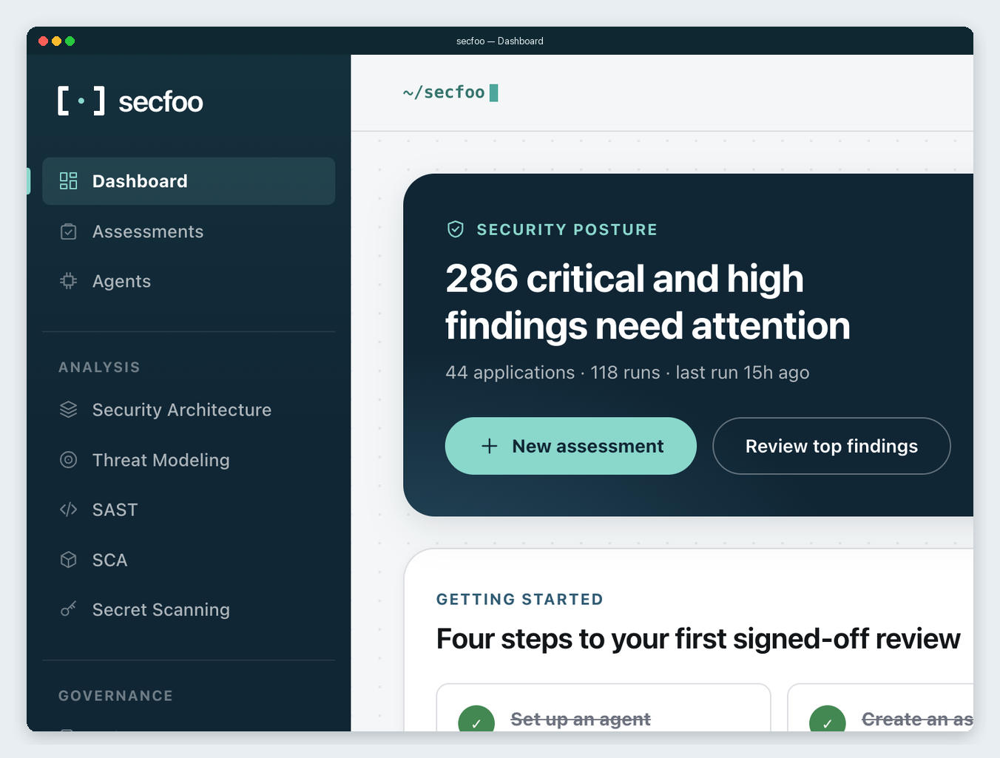
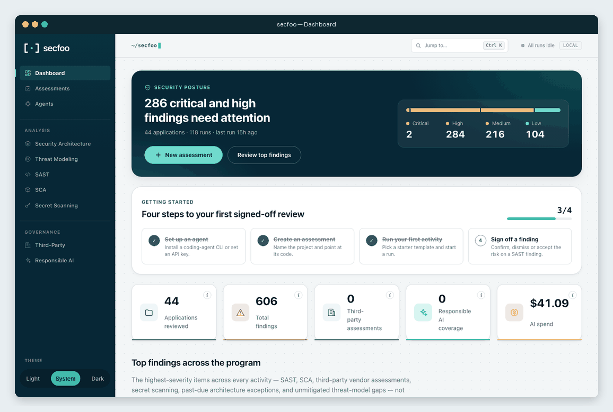
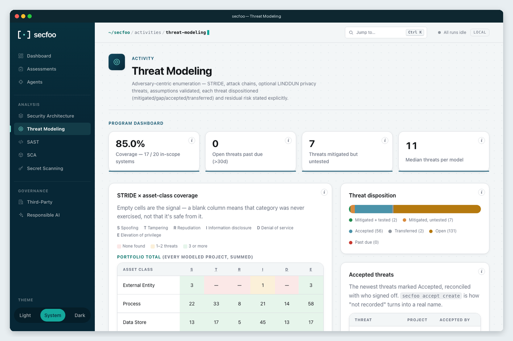
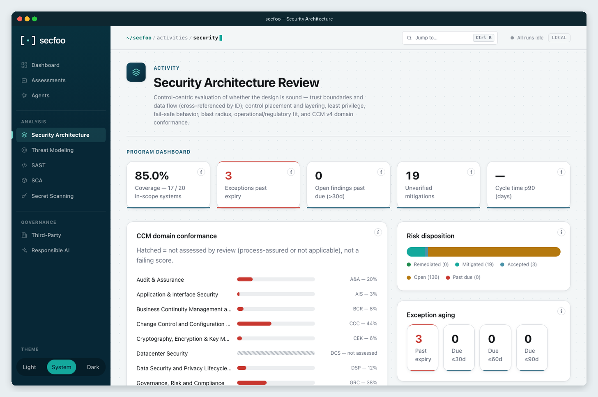

# secfoo

<p align="center">
  <strong>Turn any AI coding agent into a disciplined security reviewer.</strong><br>
  Same standards, same report, every run.
</p>

<p align="center">
  <a href="https://pypi.org/project/secfoo/"></a>
  <a href="https://pypi.org/project/secfoo/"></a>
  <a href="https://github.com/secfoo-com/secfoo/actions/workflows/ci.yml"></a>
  <a href="https://github.com/secfoo-com/secfoo/blob/main/LICENSE"></a>
</p>

<p align="center">
  
</p>

<p align="center">
  <a href="https://secfoo.com">Website</a> ·
  <a href="https://secfoo.com/docs/index.html#install">Getting started</a> ·
  <a href="https://secfoo.com/docs/cli.html">CLI</a> ·
  <a href="https://secfoo.com/docs/index.html">Docs</a>
</p>

Point Claude Code, Cursor, Antigravity, Gemini CLI, or Codex at a target.
Pick architecture review, threat modeling, SAST, and the rest of the catalog.
Browse every result in a local dashboard — `secfoo serve`, on your machine.

```bash
pip install secfoo
secfoo run --skill sast --target https://github.com/org/repo --agent claude
secfoo serve
```

You need an agent CLI already installed and authenticated
(`--agent claude|agent|agy|gemini|codex`), or an API key with the built-in
`api` agent — see [Install](#install).

## Repository targets

`--target` accepts local directories, GitHub URLs, GitLab (including nested
namespaces), and Bitbucket Cloud repositories:

```bash
secfoo run --skill sast --target https://gitlab.com/group/subgroup/repo --agent claude
secfoo run --skill sast --target https://bitbucket.org/workspace/repo --agent claude
```

GitLab and Bitbucket support HTTPS and `git@host:namespace/repo.git` SSH URLs;
`.git` is optional. SSH uses your existing SSH authentication. For self-hosted
GitLab, set `SECFOO_GITLAB_HOST` to its hostname, optionally with an HTTPS port
(e.g. `git.example.org:8443`), then pass that host's repository URL. The default
`gitlab.com` remains supported. URL credentials, queries, fragments, HTTP, and
`ssh://` forms are rejected for these new targets.

For private HTTPS repositories, provide `SECFOO_GITLAB_TOKEN` (a GitLab token
with repository read access) or `SECFOO_BITBUCKET_TOKEN` (a Bitbucket repository,
project, or workspace access token with repository read permission) through your
environment or CI secret store. Bitbucket user API tokens/app passwords are not
supported by this token mode. Tokens are supplied to Git through a temporary
askpass helper, never placed in clone arguments, repository URLs, reports, or
Git config. Git errors omit raw server output to keep credentials out of logs.
Authenticated HTTPS clones disable redirects to avoid forwarding credentials to
another host. Without a token, Git uses your existing noninteractive authentication. Clones are shallow and
removed after the run, including failures.

## A 30-second look at the dashboard

<p align="center">
  
</p>

<p align="center"><a href="docs/assets/demo.mp4">Watch as MP4</a></p>

<p align="center">
  
  
</p>

Screenshots are from a real local `secfoo serve` against public vulnerable-app targets.

## What you get

- **A skill is a brief, not a parser.** secfoo hands your coding agent a
  structured prompt and a target, then collects a report in a fixed shape.
- **One dashboard for the program.** Coverage, dispositions, STRIDE,
  design verdicts, and findings across every project you have scanned.
- **Local first.** Runs and `secfoo serve` stay on your machine. Optional
  `secfoo cloud login` syncs to an org portal that is not in this repo.
- **Concurrent by default.** Several `--skill` flags run at the same time.
- **CI-ready.** `--fail-on high`, `--max-cost 2.00`, `--json`, and distinct
  exit codes for "the scan broke" vs "policy failed". Details in
  [docs/REFERENCE.md](docs/REFERENCE.md#ci-gates-and-machine-readable-output).

## Activity catalog

| Activity | Skill ID |
|---|---|
| Security Architecture Review | `security-architecture-review` |
| Threat Modeling | `threat-modeling` |
| SAST — Static Code Analysis | `sast` |
| SCA — Reachability & Upgrade Triage | `sca-reachability` |
| Secret Scanning | `secret-scanning` |
| Prompt Review | `prompt-review` |
| Deployment Readiness | `deployment-readiness` |
| Responsible AI Compliance | `responsible-ai-compliance` |

Run one, or several together. What each report actually contains is in
[docs/REFERENCE.md](docs/REFERENCE.md).

## Install

```bash
pip install secfoo                    # PyPI, Python 3.10+
npm install -g @rakfortltd/secfoo     # npm, no Python needed
docker run --rm ghcr.io/rakfortltd/secfoo --help
```

No agent CLI? Use an API key:

```bash
pip install "secfoo[api]"
export OPENAI_API_KEY=...             # or ANTHROPIC_API_KEY / GEMINI_API_KEY
secfoo run --skill sast --agent api --target https://github.com/org/repo
```

Universal install scripts, standalone binaries, CI flags, spend tracking,
and configuration live in [docs/REFERENCE.md](docs/REFERENCE.md#install).
Developing this repo: `pip install -e ".[dev]"`.

## Learn more

- [docs/REFERENCE.md](docs/REFERENCE.md) — catalog, dashboards, assessments, config, distribution
- [Getting started](https://secfoo.com/docs/index.html#quickstart)
- [CLI reference](https://secfoo.com/docs/cli.html)
- [Running an assessment](https://secfoo.com/docs/guide-running-an-assessment.html)
- [Editions](https://secfoo.com/editions.html)

## Contributing

PRs welcome — see [CONTRIBUTING.md](CONTRIBUTING.md) and
[CODE_OF_CONDUCT.md](CODE_OF_CONDUCT.md). Security issues go through
[SECURITY.md](SECURITY.md), not a public issue.
