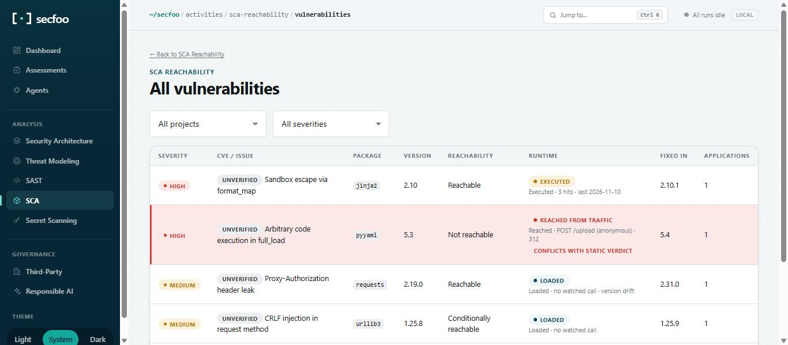

# Reference

The full activity catalog, dashboards, assessments, configuration, and distribution details -- moved out of the README to keep that short. See the [main README](../README.md) for the dashboard screenshots and Quick Start.

## Activity catalog

Each activity is a self-contained security engagement with its own report
shape. Run one, or several together — multiple activities execute
concurrently against the same target.

| Activity | Skill ID | What it produces |
|---|---|---|
| Security Architecture Review | `security-architecture-review` | Controls matrix (presence / placement / layering), design-principles verdict, operational & regulatory fit, CSA CCM v4 domain conformance, and a **Design verdict** for milestone gating — plus a program-level dashboard, see below |
| Threat Modeling | `threat-modeling` | Adversary classes, STRIDE (+ LINDDUN when personal data is in scope), attack chains, every threat dispositioned Mitigated/Gap/Accepted, and an explicit **residual risk** statement |
| SAST — Static Code Analysis | `sast` | Code-level findings with taint paths, CWE/OWASP mapping, and illustrative fix diffs |
| SCA — Reachability & Upgrade Triage | `sca-reachability` | Dependency inventory, **reachability verdict** per risk, and a grouped upgrade plan |
| Secret Scanning — Code, Confluence & Docs | `secret-scanning` | Exposed credentials across source, config, git history, and linked Confluence pages, with a rotation-first remediation list |
| Prompt Review | `prompt-review` | LLM prompt, tool-definition, and agent-behavior security review |
| Deployment Readiness | `deployment-readiness` | Production security and operational readiness review |
| Responsible AI Compliance | `responsible-ai-compliance` | Governance, transparency, fairness, and oversight review (drives the dashboard's Responsible AI risk badges) |

### Architecture review vs. threat modeling

These two look adjacent but answer different questions and fail
differently, so secfoo keeps them separate rather than merging them into
one "threat assessment":

- **Security Architecture Review** asks *is this design sound?* It is
  control-centric and evaluative — you judge components, boundaries, and
  topology against secure design principles and compliance baselines. Are
  controls present, correctly placed, and layered? Is least privilege
  enforced by the topology or merely by policy? Does the design fail safe?
  It also covers ground with no attacker at all: recoverability, key
  lifecycle, maintainability, regulatory fit.
- **Threat Modeling** asks *what could go wrong, and who would make it go
  wrong?* It is adversary-centric and generative — enumerate threats from
  assets and trust boundaries, then disposition each as mitigated,
  accepted, or a gap, and state residual risk explicitly.

An architecture review can pass every checklist item and still miss a
threat nobody enumerated. A threat model can list fifty threats and still
miss that the design has no blast-radius containment. Run both.

Adding an activity is a matter of dropping a Markdown file into
[`src/secfoo/skills/definitions/`](../src/secfoo/skills/definitions/) — the CLI
choices, the web run form, the dashboard's coverage panel, and the
per-activity pages are all derived from that directory, so there is no
registry to keep in sync.

In the dashboard, the six focused analysis activities each get their own
page under **Analysis** in the sidebar (`/activities/<skill-id>`), showing
which projects have been scanned with that activity, when, and what it
found. Each project's own page mirrors it with an **Activity coverage**
table — including the activities that have *never* been run against it,
since that gap is usually the point.

### Architecture diagrams

Security Architecture Review and Threat Modeling reports include a
[Mermaid](https://mermaid.js.org/) data-flow diagram with one subgraph per
trust zone. Mermaid source is readable as-is, so it always appears in the
report; to render it as a picture in the dashboard, fetch the renderer once:

```bash
secfoo vendor mermaid      # ~3.6MB, stored in ~/.secfoo/vendor/
```

It's not bundled by default because it's an order of magnitude larger than
the rest of secfoo. It's served locally afterwards — the dashboard never
calls out to a CDN while you're reading a report — and rendered with
Mermaid's `securityLevel: "strict"`, since report content originates from
an agent reading a possibly untrusted repository. No outbound access on the
box? Copy the file to `~/.secfoo/vendor/mermaid.min.js` by hand.

### Keeping a scan focused

Vendored copies and unrelated repos checked out inside a project dilute
reports and cost tokens. Exclude them per run or permanently:

```bash
secfoo run --skill sast --exclude vendor/ --exclude some-cloned-repo/
```

```toml
# ~/.secfoo/config.toml — applies to every run
[defaults]
exclude = ["vendor/", "some-cloned-repo/"]
```

Exclusions are always **additive**: `--exclude` adds to `[defaults].exclude`,
which adds to secfoo's built-in list (`node_modules/`, `.git/`, `dist/`, …).
Naming one path can never silently re-enable scanning of the others.

### Security Architecture program dashboard

The Security Architecture Review activity page
(`/activities/security-architecture-review`) is a program-level view on top
of the per-project reports: coverage, exceptions, a findings-disposition
approximation, a **CSA Cloud Controls Matrix (CCM v4)** conformance
heatmap, recurring root causes, and gate-decision (approve / with
conditions / reject) mix — derived from the Design Verdict, CCM Domain
Conformance table, and Standard column the skill's report contract now
produces (v4).

This is deliberately built from what a report can state at review time and
the exceptions you record — not a separate persistent findings-lifecycle
system with manually-updated statuses. A few panels are therefore honest
approximations, not exact tracking:

- **Open findings past due** / **remediated** — no per-finding due date or
  close event exists, so "past due" means a Confirmed-verdict finding
  whose *most recent* review is older than 30 days, and "remediated" means
  the total finding count dropped between a project's two most recent
  reviews (it can't say *which* finding closed).
- **In scope** (for the Coverage % tile) means "has an assessment" — there
  is no separate system registry, so a project secfoo has never heard of
  can't appear as an uncovered denominator.
- **CCM conformance** is domain-level (17 domains), not the ~200
  individual CCM controls — an LLM review scoring every control
  individually each run would cost far more than it's worth. A domain the
  report marks `Not Assessed (process-assured)` (e.g. Human Resources
  Security, usually governed by an external process a codebase can't
  reveal) shows hatched on the heatmap rather than scored.

Reports from before this contract version (or from other skills) simply
show zeros/hatching for panels they have no data for, rather than
guessing.

### Threat Modeling program dashboard

The Threat Modeling activity page (`/activities/threat-modeling`) is the
same kind of program-level view, built on the same ground rules: coverage,
a **per-project STRIDE × asset-class coverage matrix** (empty cells are
the signal — a blank category was never exercised on *that* project, not
proven safe; kept per-project rather than aggregated, since averaging
across projects would blend one project's real gap into another's totals
and hide which system actually has it), threat disposition
(mitigated-and-tested / mitigated-untested / accepted / transferred / open
/ past due), recorded risk acceptances, models needing rework, recurring
**threat archetypes** across every model run, a model-depth mix (Full /
Feature-level / Lightweight), threats found post-build, and falsified
assumptions — all derived from the Threat Register, Assumptions, and
Executive Summary sections the skill's report contract now produces (v3).

The page shows only this specialized dashboard, not the generic
per-activity stat-card block (Projects covered / Runs / Total findings /
Critical + High) or diagram gallery every other activity page gets —
both would just duplicate tiles this dashboard already covers more
specifically.

Approximations, called out the same way as the architecture dashboard:

- **Open threats past due** uses the same 30-day-since-last-model proxy as
  Security Architecture Review's "past due" tile, for the same reason (no
  per-threat due date exists).
- **Mitigated but untested** means the Threat Register's Disposition is
  `Mitigated` but its Test Reference column is `none` — a claimed
  mitigation the model didn't verify with an actual test.
- **Models needing rework** collapses "stale (boundary moved / new
  integration / new data class)" and "superseded by a design change" into
  the one structural signal actually derivable from report text: a
  different trust-boundary count between a project's two most recent
  models. It's sorted by total findings count as a criticality proxy,
  since no separate criticality field or system registry exists.
- **Accepted threats** (the flat, report-derived list) reflects the
  model's own Disposition call, with no named human owner — see
  **Recorded risk acceptances** below for the actual loop-back.
- **Recurring threat patterns** is exact-string aggregation over the
  Threat Register's **Archetype** column (a short, deliberately reusable
  phrase like "Unauthenticated internal service call" the skill is
  instructed to reuse verbatim for the same underlying pattern) — not NLP
  clustering.
- **Threats found post-build** is inherently not derivable from any
  report — a model can't know what it missed — so it's recorded by hand
  with `secfoo miss`, the same rationale as `secfoo exception`.

**Accepting a threat.** A report's own `Accepted` disposition is just the
model's judgment call at review time — there's no button in the report
that a human actually clicked. `secfoo accept` is that loop-back: a named
owner and justification for accepting one specific threat, recorded
independently of the report and re-shown on every future dashboard load
even after the model re-runs and its Threat Register changes:

```bash
secfoo accept create --project . --threat-id T4 --title "Legacy endpoint risk" \
  --justification "Endpoint is being decommissioned next quarter" \
  --accepted-by "Jane Doe" --expires-at 2026-12-01

secfoo accept list --status active
secfoo accept update 1 --status revoked
secfoo accept delete 1
```

### Exceptions

A risk acceptance against a project, with an expiry the dashboard tracks:

```bash
secfoo exception create --project . --title "Legacy auth exemption" \
  --justification "Migration in progress, tracked in JIRA-123" \
  --granted-by "Jane Doe" --expires-at 2026-09-01 --control IAM

secfoo exception list --status active
secfoo exception update 1 --status revoked
```

`--control` is free text — typically a CCM domain code (`IAM`, `CEK`, …) or
a standard clause (`"SOC 2 CC6.1"`) — surfaced on the dashboard's exception
aging panel (30/60/90-day buckets, past-expiry highlighted).

### Post-build findings

A threat an earlier model missed — found by an incident, a pen test, or a
later scan — recorded by hand since nothing in a report can know what it
missed:

```bash
secfoo miss create --project . --title "SSRF via webhook URL" \
  --discovered-at 2026-08-01 --discovered-by "Pen test Q3" \
  --description "Webhook target URL wasn't validated against internal IP ranges" \
  --run <run-uuid>   # optional: the threat model that should have caught it

secfoo miss list
secfoo miss show 1
secfoo miss delete 1
```

Feeds the Threat Modeling dashboard's "Threats found post-build" panel
(recent-90-day trend + all-time count).

### Secret Scanning program dashboard

The Secret Scanning activity page (`/activities/secret-scanning`) is a
program-level view of exposed credentials across every project: a findings
funnel emphasizing **Looks live** credentials (rotate immediately), a
severity breakdown, a source breakdown (code / config / version-control
history / documentation), and a cross-project findings register with
evidence, exposure analysis, and remediation text pulled from each report.

Like SCA and Threat Modeling, this dashboard is derived fresh from report
text on every request — there is no persistent per-finding lifecycle.
Findings link to a detail page keyed by `(project, finding ID, type,
location)` so duplicate rows in a report remain addressable.

### SAST Open/Closed finding identity

The SAST activity dashboard (`/activities/sast`) is the one program view
with a **persistent per-finding lifecycle** (`sast_findings` table). After
each successful local `sast` run, secfoo parses the report's **Findings
Register** (structured columns the skill contract requires) and upserts by
fingerprint; findings not seen again are closed.

**Fingerprint (no embedding or title matching):**

| Input | Used for identity? |
|-------|-------------------|
| Skill id (`sast`) | Yes |
| CWE (register column) | Yes |
| Normalized file path (Location column) | Yes |
| Source **code-region hash** (±4 lines at reported line, from repo on disk) | Yes, when `workdir` is available |
| Title, description, recommendation | No — refreshed each run for display |
| Per-run `F1`, `F2` ids | No |
| Exact line number | No — except cloud-ingest fallback (below) |

When the scan target is on disk (`secfoo run`), `report/code_region.py`
hashes a small normalized window of source at the line in the Location
column. Two distinct issues in the same file (same CWE) get different keys
even if the agent rephrases titles. When only the report is available
(e.g. `secfoo cloud sync` ingest), identity falls back to CWE + path, with
a coarse line-bucket only if multiple register rows in **one** report share
the same CWE and file.

Open rows keyed with the legacy fingerprint are **rekeyed** automatically
on the first rescan that computes a region hash. There is no post-hoc
embedding similarity on finding text.

### Structured findings (SAST, SCA, secret scanning)

SCA and secret-scanning runs get the same open/closed lifecycle as SAST,
in their own tables (`sca_findings`, `secret_findings`). Each finding also
records:

- **`language`** and **`framework`**: detected from the files on disk
  (extensions and dependency manifests, see `stack.py`), never taken from
  the model's own prose. SCA findings take their language from the
  package's ecosystem.
- **`construct`**: the report's `**Construct:**` line. This is a one-line,
  code-free description of the vulnerable construct ("YAML loader without
  a safe loader applied to an uploaded config file"). Because it has no
  paths or identifiers, findings can be compared across repos.

| Skill | Identity (fingerprint) |
|---|---|
| `sca-reachability` | ecosystem + package, plus the advisory ID when the report names a real one (`CVE-…`, `GHSA-…`, `PYSEC-…`). The version is not part of the key, so a bump that doesn't fix the issue keeps the same open finding. |
| `secret-scanning` | secret type + normalized path + code-region hash (or a same-run line bucket, as with SAST) |

Secret evidence is cut back down to its first 8 characters before it is
stored, even when a report includes more.

### Structured findings export

```bash
secfoo findings export                       # open findings, every skill, JSON Lines to stdout
secfoo findings export -s sast --status all  # one skill, open and closed
secfoo findings export --no-locations -o findings.jsonl   # drop paths/lines/region hashes
```


Use `--format sarif` to write a SARIF 2.1.0 document instead of JSON Lines
(the default). The same `--skill`, `--project`, `--status`, and
`--no-locations` options apply to both formats. Export one project at a time
when uploading to code scanning so paths belong to the checked-out repository.
Relative paths should be relative to that repository; absolute paths are emitted
as `file:` URIs. Missing files or invalid line numbers omit the corresponding
location or region rather than inventing one.

```bash
secfoo findings export --format sarif --project 1 -o findings.sarif
```

After a scan has populated secfoo's local findings database, upload the export
in a GitHub Actions job (the checkout, scan and export must use the same runner
and secfoo store):

```yaml
permissions:
  contents: read
  security-events: write
steps:
  - uses: actions/checkout@v4
  # Install secfoo and run your assessment here to populate the local store.
  - name: Export findings
    run: secfoo findings export --format sarif --project 1 -o findings.sarif
  - uses: github/codeql-action/upload-sarif@v4
    with:
      sarif_file: findings.sarif
      category: secfoo
```

Replace `1` with the scanned project's local ID. GitHub code scanning must be
available and enabled for the repository. Use the default open status for uploads;
`--status all` also exports closed findings as results.

SARIF rules are grouped by skill, CWE and severity so different severities for
the same CWE retain their own rule-level `security-severity`. Critical/high map
to `error`, medium to `warning`, and low/informational to `note`. Their categorical
security scores are `9.0`, `7.0`, `4.0`, `1.0`, and `0.0`, respectively; these are
not calculated CVSS scores. Unknown severities use `warning` without a security
score. CWE tags use `external/cwe/cwe-N`. Findings without a CWE still get a rule.
`--no-locations` removes the same structured location fields as JSONL and omits
SARIF locations; free-text finding titles and descriptions are not redacted.

### Runtime evidence

Runtime evidence records what a running app actually did with a vulnerable
dependency: whether it was loaded, whether a watched vulnerable function was
called, and on which route. It is **opt-in**: nothing produces it unless you
deploy a probe or sensor, or import a coverage file. Without it, SCA findings
work exactly as before. Design rules and roadmap: issue #51.

```bash
secfoo runtime ingest events.ndjson --project payments   # project id, name, or scanned path/URL
```

`ingest` stores the events against the project's SCA findings. It skips
malformed lines and hits for unknown findings, lists each one with its line
number, and still stores the rest; it exits `1` if anything was skipped.
Ingesting the same file twice updates rows instead of double-counting.

**Event file:** NDJSON, one JSON object per line. A `session` line, then any
number of `load` and `hit` lines that reference it by `session` id. A later
file may add hits to a session stored earlier. The JSON Schema is
[`src/secfoo/runtime/evidence.schema.json`](../src/secfoo/runtime/evidence.schema.json).

```json
{"type":"session","id":"<uuid>","language":"python","runtime":"3.12.4","source":"sensor","started_at":"2026-11-08T10:00:00Z","ended_at":"2026-11-08T16:00:00Z","app":"payments-api","env":"prod","instance":"pod-1","sensor_version":"0.4.0","app_functions_total":1840,"app_functions_executed":1362}
{"type":"load","session":"<uuid>","ecosystem":"PyPI","package":"pyyaml","version":"5.3","path":"/app/.venv/lib/python3.12/site-packages/yaml","first_seen":"2026-11-08T10:00:01Z"}
{"type":"hit","session":"<uuid>","finding_fingerprint":"<sca_findings.fingerprint>","symbol":"yaml.load","route":"POST /upload","auth":"anonymous","count":312,"first_seen":"2026-11-08T10:05:00Z","last_seen":"2026-11-08T15:59:00Z","entry_frame":"app/routes/upload.py:42","stack_sample":["app/routes/upload.py:42","app/services/parse.py:17"]}
```

| Line | Required | Optional |
|---|---|---|
| `session` | `id` (producer's own UUID), `language` (`python` `node` `jvm` `dotnet` `go` `rust` `ruby` `php` `native`), `source` (`sensor` or `coverage`), `started_at` | `runtime`, `ended_at`, `app`, `env`, `instance`, `sensor_version`, `app_functions_total`, `app_functions_executed` |
| `load` | `session`, `ecosystem` (OSV name), `package`, `version` | `path`, `first_seen` |
| `hit` | `session`, `finding_fingerprint`, `symbol`, `count` (≥ 1) | `route`, `auth` (`anonymous` or `authenticated`), `first_seen`, `last_seen`, `entry_frame`, `stack_sample` |

- Timestamps are ISO 8601.
- A hit's `count` is the session's **running total** for its (fingerprint,
  symbol, route), so a producer can flush the same session repeatedly and
  the stored value is replaced, never summed.
- `route` is a template (`POST /upload`), `job:<name>`, `startup` or
  `unknown`, never a concrete URL. Values with a scheme (`://`), query string
  or fragment are rejected.
- `entry_frame` and `stack_sample` (at most 50 frames) are `file:line` frames
  only. Producers drop frames outside the app (site-packages, node_modules)
  except the vulnerable function itself.
- Only the fields above are stored. Anything else on a line is ignored and
  never written, so argument values, request bodies and headers can't reach
  the database even if a producer sends them.
- `app_functions_total` / `app_functions_executed` record how much of the
  app the observed traffic covered. "Not observed" is always shown with this
  coverage, never as "not reachable".

**Watchlist.** Probes need to know which functions to watch. Build the list
from a project's open SCA findings:

```bash
secfoo runtime watchlist --project payments -o watchlist.json
secfoo runtime watchlist --project payments --ghsa -o watchlist.json   # also ask GitHub's advisory API
```

Symbols come from the OSV records SCA runs already cached, so there are no
network calls by default:

- Go advisories' `ecosystem_specific.imports[].symbols`, joined with the
  import path (`golang.org/x/net/html.Parse`).
- RustSec's `affects.functions`.

`--ghsa` adds GitHub's `vulnerable_functions` when OSV has none. That API is
unauthenticated and rate-limited, so the build stops asking at the first
limit. A finding that names an advisory gets only that advisory; an
`unverified` one gets every advisory OSV has for its package and version.
When no symbols are known, the entry stays in the list at
`"granularity": "package"` and the probe records whether the package was
loaded. Entries are never dropped. Schema:
[`src/secfoo/runtime/watchlist.schema.json`](../src/secfoo/runtime/watchlist.schema.json).

```json
{"version": 1, "generated_at": "2026-11-08T12:00:00Z", "entries": [
  {"finding_fingerprint": "<sca_findings.fingerprint>", "advisory": "GHSA-vvpx-j8f3-3w6h", "ecosystem": "Go",
   "package": "golang.org/x/net", "version": "0.6.0", "granularity": "symbol",
   "symbols": ["golang.org/x/net/http2/hpack.Decoder.DecodeFull"], "source": "osv"}
]}
```

Symbols use one notation per ecosystem, and probes in every runtime match
these exact forms. A symbol that doesn't fit is left out, with a note.

| Ecosystem | Notation | Example |
|---|---|---|
| PyPI | `module.qualname` | `yaml.load` |
| npm | `package#export.path` | `lodash#template` |
| Maven | `fully.qualified.Class#method` | `org.apache.logging.log4j.core.lookup.JndiLookup#lookup` |
| NuGet | `Namespace.Type#Method` | `System.Text.Json.JsonSerializer#Deserialize` |
| Go | `importpath.Func` / `importpath.Type.Method` | `golang.org/x/net/html.Parse` |
| crates.io | `crate::path::fn` | `hyper::proto::h1::role::parse_headers` |
| RubyGems | `Class#instance_method` / `Class.class_method` | `Nokogiri::XML::Document.parse` |
| Packagist | `Namespace\Class::method` or `function` | `Symfony\Component\Yaml\Yaml::parse` |

**Storage** (in `schema.sql`, added automatically to existing stores):
`runtime_sessions` (one row per session), `runtime_evidence` (per session,
finding, symbol and route, with a foreign key to `sca_findings`) and
`runtime_packages` (loaded inventory per session). Validation and storage
live in `secfoo/runtime/evidence.py` (`ingest_events`), which the live
ingest API will reuse.

**In the dashboard.** Once a project has runtime data, the SCA
vulnerabilities list gets a **Runtime** column. Each finding shows the
strongest state seen across the projects it affects:

| State | Meaning |
|---|---|
| Reached from traffic | A watched symbol ran while handling a request route (shows route, auth state and hits). |
| Executed | It ran, with no request context (startup, a job, or no route). |
| Loaded | The package was in memory, but no watched symbol was called. Flags version drift when the loaded version differs from the scanned one. |
| Not loaded / Not observed | Sessions exist, nothing was seen for this finding. Always shown with the coverage % and observation time. |
| No runtime data | No sensor or coverage import for the project. |

A finding the static scan rated **Not reachable** whose code was Executed or
Reached is highlighted as a conflict. The vulnerability page shows sessions,
routes, entry frames and stack samples. The SCA overview counts
runtime-confirmed findings, but only once there is runtime data.



### Coverage files as runtime evidence

The easiest evidence needs no sensor: coverage from your test suite or a
staging run.

```bash
coverage run --source=app,yaml,jinja2 -m pytest && coverage json         # include the dependencies you watch
secfoo runtime import-coverage coverage.json --watchlist watchlist.json -o events.ndjson
NODE_V8_COVERAGE=./v8-cov node app.js
secfoo runtime import-coverage ./v8-cov --watchlist watchlist.json -o events.ndjson
secfoo runtime ingest events.ndjson --project payments
```

- **Python:** a coverage.py JSON report from coverage 7.5 or later, which has
  per-function data. coverage.py **omits site-packages by default**, so
  measure the watched packages with `--source` or `[run] include`; the command
  says so when no dependency files are in the report.
- **Node:** a V8 coverage folder, or one of its files. Its function ranges
  already include `node_modules`.

A watched symbol counts as **Executed** when its function ran. Coverage has no
routes or stack traces. The session line gets the app's own function
coverage. The session id comes from the file contents, so re-importing the
same coverage never double-counts.

### Python probe

The probe runs inside a Python app and records which watched vulnerable
functions actually run. It writes the event format above.

```bash
secfoo runtime watchlist --project payments -o watchlist.json
secfoo instrument --watchlist watchlist.json -o events.ndjson -- python app.py   # or gunicorn ..., uvicorn ...
secfoo runtime ingest events.ndjson --project payments
```

`secfoo instrument` starts the probe in every Python process the command
launches, workers included, without changing the app's start command. It
does this through a temporary `sitecustomize` on `PYTHONPATH`. When you can't
wrap the command, set the variables yourself:

```bash
SECFOO_SENSOR=1 SECFOO_WATCHLIST=watchlist.json SECFOO_EVENTS_OUT=events-{pid}.ndjson python -m secfoo.sensor app.py
```

| Variable | Meaning |
|---|---|
| `SECFOO_SENSOR=1` | Required. Without it the probe installs nothing: no hooks, threads or connections. |
| `SECFOO_WATCHLIST` | The watchlist file. It is re-read when its mtime changes (checked at most every 30 s). |
| `SECFOO_EVENTS_OUT` | The events file. `{pid}` gives each process its own file; otherwise processes append to one file safely. |
| `SECFOO_SENSOR_ADDR` | Send to a sensor instead: `unix://…`, `tcp://127.0.0.1:port` (loopback only), `npipe://…`, `https://…` (direct mode, using the runtime ingest API with `SECFOO_API_KEY_FILE` / `SECFOO_PROJECT`), or `file://…`. |
| `SECFOO_FLUSH_INTERVAL` | Seconds between flushes (default 10). It also flushes at exit. |
| `SECFOO_APP_ROOT` | The app's own code, for coverage and stack frames (default: the working directory). |

**How it works.**

- **Backends.** On Python 3.12+ it uses `sys.monitoring` (PEP 669), with
  `PY_START` events only on the watched functions' code objects, so unwatched
  code costs nothing. On 3.10/3.11 it falls back to `sys.setprofile` and
  `threading.setprofile`.
- **Symbols** are resolved as their modules are imported.
- **Coverage.** Each app function is counted the first time it runs, for
  `app_functions_executed`. On 3.12+ that event is then disabled for the
  function.
- **Inventory.** It emits `load` lines for installed distributions whose
  top-level module was imported.
- **Workers.** Each process, including forked or spawned workers (gunicorn,
  uvicorn, multiprocessing), is its own session. With gunicorn `--preload`,
  the probe starts in the master and each forked worker starts a new session
  automatically.

**Guarantees.**

- It never reads `frame.f_locals`, arguments or return values. It records
  only function identity, counts, timestamps and `file:line` app frames.
- An internal error disables the probe, with one stderr line, and never
  reaches the app.
- Transports run on a background thread and drop data rather than block
  when the destination is gone.
- It opens no connection other than `SECFOO_SENSOR_ADDR`.

**Overhead** (`python benchmarks/sensor_overhead.py`, CPython 3.14, a ~7 µs
request-like handler):

| Mode | Unwatched code | Watched function called on every request |
|---|---|---|
| `sys.monitoring` (3.12+) | ≈ 0% | ~20% (≈ 1.4 µs per watched call) |
| `setprofile` fallback (3.10/3.11) | ~10× slower | ~10× slower |

The fallback fires on every Python call, so prefer 3.12+ in production or
keep the fallback to staging.

### Runtime evidence in the CLI and CI

Runtime evidence is most useful where fixes are chosen: in the branch, the PR
and CI. The CLI attaches it to findings automatically.

```bash
secfoo findings list                           # Runtime column; sorted by severity, then by what production saw
secfoo findings show 3f2a9c                    # one finding, its routes and a "Fix first" hint
secfoo findings export --format sarif --runtime-priority -o findings.sarif
secfoo findings check --fail-on reached:high   # CI gate: exit 4 if an open High+ finding is reached in production
```

Evidence comes from two places, and the stronger state wins:

- **The local store**, for anything ingested here or by a self-hosted
  `secfoo serve` that shares the store.
- **The server your `secfoo cloud login` key belongs to**, via
  `GET /api/runtime/v1/evidence`. The answer is cached under
  `$SECFOO_HOME/runtime-cache/`, so offline runs reuse the last one.

With no key, no network call is made. **No runtime data** is the normal state
when no sensor is deployed, not an error. `--no-runtime` skips all of it.

- **Ordering** within each severity: Reached, Executed, Loaded, No runtime
  data, Not observed / Not loaded. Not-observed findings are never hidden, and
  always show their coverage.
- **SARIF.** Each SCA result carries `properties.secfoo.runtime` (state,
  summary, routes, hits, last seen, version drift). A reached finding's
  message says "Reached in production via …". `--runtime-priority` raises
  reached findings to `error`.
- **Gate.** `--fail-on reached[:<severity>]` counts findings reached on a
  request route. `executed[:<severity>]` also counts code that ran with no
  request context. The gate exits **`4`** (distinct from `1`, `2` and `3` of
  `secfoo run`) and is off unless you run it.
- **After `secfoo run`**, when runtime data exists for the project, the
  summary adds one line, e.g. *"2 of 12 findings are reached in production:
  D2 (POST /upload, anonymous), …"*.

### Runtime ingest API

Live sensors send evidence to the same server your CLI results go to. They
authenticate with **the same Secfoo API key**, so one key gives one view of
static findings and runtime evidence. `secfoo serve` implements this API; the
hosted service implements the same contract.

**On a self-hosted `secfoo serve`, issue a key:**

```bash
secfoo serve key create --name payments-prod-sensor --project payments-api --runtime-only
secfoo serve key list
secfoo serve key revoke 3
secfoo cloud login --api-key <key> --portal-url https://secfoo.internal   # the CLI shares the same key
```

The key is printed once. Only a SHA-256 of it is stored. `--project` limits a
key to one project, and `--runtime-only` limits it to these endpoints; both
are recommended for production clusters.

**Sensor configuration**, set explicitly at deploy time:

```bash
SECFOO_API_KEY_FILE=/var/run/secrets/secfoo/api-key   # or SECFOO_API_KEY; mount it from a secret, never bake it into an image
SECFOO_SERVER=https://secfoo.internal                 # default: the portal URL `secfoo cloud login` saved
SECFOO_PROJECT=https://github.com/acme/payments-api   # the identifier exactly as `secfoo run` recorded it
SECFOO_APP=payments-api
SECFOO_ENV=prod
```

A missing key, server or project is an error. There is no fallback account.
`SECFOO_SERVER` must be `https://`, or a loopback `http://` address.

**Endpoints** (`Authorization: Bearer <key>`; `project` is required on each):

| Endpoint | Purpose |
|---|---|
| `GET /api/runtime/v1/watchlist?project=` | The watchlist above, with an `ETag`. Send `If-None-Match` to get a cheap `304`. |
| `POST /api/runtime/v1/events?project=&app=&env=` | An NDJSON batch in the evidence format (gzip allowed, `Content-Encoding: gzip`). It uses the same validation and idempotent upsert as `secfoo runtime ingest`, so a retried batch never double-counts. `app` / `env` fill session lines that don't set them. Returns the counts stored and any skipped lines. |
| `POST /api/runtime/v1/heartbeat?project=` | JSON `{sensor_id, version, app, env, instances, dropped}`. Registers the sensor and sums dropped events. |
| `GET /api/runtime/v1/evidence?project=` | The runtime state of each open SCA finding (state, routes, coverage, conflict), for the CLI and CI. |

- **Errors:** `401` for a missing, unknown or revoked key; `403` for a key
  without access to the project; `404` for an unknown project (it is not
  auto-created; run `secfoo run` first); `413` for oversized batches; `429`
  when rate-limited.
- **Limits:** 5 MiB request body, 20 MiB decompressed, 50,000 lines per
  batch, and 120 requests per minute per key.
- **Logging:** keys and event payloads are never logged or echoed in errors.

**TLS.** `secfoo serve` binds `127.0.0.1` by default. On any other `--host`,
it refuses API keys over plain HTTP. Put a TLS-terminating proxy in front
(e.g. Caddy, nginx, or a cloud load balancer forwarding `X-Forwarded-Proto`)
and run uvicorn behind it. `--allow-insecure-runtime` disables the check, for
a trusted private network only.

## Install

Pick whichever fits how you work — they're all the same tool underneath.

```bash
# PyPI (needs Python 3.10+)
pip install secfoo

# npm (no Python needed -- installs a real standalone binary, not a
# Python wrapper; see the "Distribution" section below for why)
npm install -g @rakfortltd/secfoo

# Universal installer script (macOS/Linux, no Python or Node needed)
curl -fsSL https://raw.githubusercontent.com/rakfortltd/secfoo/main/install.sh | sh

# Windows (PowerShell), no Python or Node needed
irm https://raw.githubusercontent.com/rakfortltd/secfoo/main/install.ps1 | iex

# Docker (nothing installed on the host at all)
docker run --rm ghcr.io/rakfortltd/secfoo --help

# Or grab a binary directly for your platform from the Releases page:
# https://github.com/rakfortltd/secfoo/releases
```

Developing on this repo instead? `pip install -e ".[dev]"`.

## Usage

```bash
# Run a skill against the current directory with Claude Code
secfoo run --skill security-architecture-review --agent claude

# Run multiple skills against a GitHub repo, with Confluence context
secfoo run \
  --skill security-architecture-review --skill threat-modeling \
  --target https://github.com/org/repo \
  --confluence https://yourcompany.atlassian.net/wiki/spaces/SEC/pages/123 \
  --agent agent

# See what's on PATH
secfoo agents

# List past runs
secfoo list

# View a single run's report in the terminal
secfoo show <run-uuid>

# Launch the local dashboard
secfoo serve

# AI spend across past runs
secfoo cost --by skill --since 2026-09-01
```

### CI gates and machine-readable output

```bash
secfoo run --skill sast --skill secret-scanning --agent api --target . \
  --fail-on high --max-cost 2.00 --json > secfoo-result.json
```

| Flag | Effect |
|---|---|
| `--fail-on critical\|high\|medium\|low` | Exit `2` if any run reports a finding at that severity or worse. Counts come from the report contract's `### [SEVERITY] Fn:` headings, not from prose. |
| `--max-cost <usd>` | Exit `3` if the summed agent-reported spend for this invocation exceeds the cap. Evaluated after the runs complete. |
| `--max-input-tokens <n>` | `api` agent only. Checked **before** the model is called: if the assembled prompt (brief + target source) is larger than `n` input tokens, the run fails without sending anything, and the error says how large the prompt was and which limit applied. Token counts come from LiteLLM's tokenizer for the model, or ~4 characters per token when it has none. Falls back to `[agents.api].max_input_tokens`. Other agents read the target themselves, so they warn and ignore it. |
| `--json` | Write one JSON document to stdout (per-skill status, severity counts, tokens, USD, gate verdicts, resolved exit code); progress and notes go to stderr. Also suppresses the interactive project-name prompt. |

Exit codes: `0` clean, `1` a run failed or timed out (gate verdicts are
still reported in the JSON but a partial scan never passes), `2` all runs
succeeded but the findings gate tripped, `3` all runs succeeded but the cost
gate tripped. If both gates trip, `3` takes precedence so CI can distinguish
budget overruns. Config-file defaults: `[defaults].fail_on`
and `[defaults].max_cost_usd`.

Cost provenance: `api`/`secfoo` take LiteLLM's `completion_cost`, `claude`
takes `total_cost_usd` from `--output-format json`, `gemini` reports tokens
only, `agent`/`agy` report nothing. Runs with no reported cost count as
`unpriced_runs` in the JSON and in `secfoo cost`; they never pass a cap as
"$0". The enterprise portal stores the client-reported tokens/USD on
ingest — spend can't be recomputed server-side from report text the way
severity counts are.

## Assessments

An **assessment** is a case-file container -- an Application ID / Security
Assessment Request, a review status (Ready → In Progress → Completed →
Blocked), and one or more attached runs and/or uploaded files (e.g. an
AI-BOM inventory). Runs can attach to a case file at creation time; the
dashboard's Assessments, Third-Party, and Responsible AI pages are all
built on top of this.

```bash
# Create a case file
secfoo assessment create --project https://github.com/org/vendor-app \
  --type third-party --app-id APP-042 --sar SAR-2026-0007 --reviewer "Jane Doe"

# Attach a skill run to it directly
secfoo run --skill security-architecture-review --agent claude --assessment 1

# Upload an AI-BOM file (parsed automatically -- see secfoo/aibom.py for the schema)
secfoo assessment upload 1 ai-bom.json

secfoo assessment list --type third-party --status in_progress
secfoo assessment show 1
secfoo assessment update 1 --status completed
secfoo assessment delete 1
```

Responsible AI risk badges in the dashboard are derived automatically from
an assessment's attached Responsible AI Compliance run (its `Overall risk
rating` line) rather than set manually, and stay "provisional" until the
assessment's own status is marked Completed.

## Configuration (`~/.secfoo/config.toml`)

Set default agent/depth/timeout and MCP servers (e.g. Confluence/Jira via
Atlassian's Rovo MCP server) once, instead of passing flags every time or
wiring each agent CLI separately.

```bash
secfoo config init      # writes a starter ~/.secfoo/config.toml
```

```toml
[defaults]
agent = "claude"
depth = "quick"
# Vendored copies / unrelated repos checked out inside a project. Added to
# the built-in exclusions (node_modules/, .git/, ...), never replacing them.
exclude = ["vendor/", "some-cloned-repo/"]
# CI gates (see "CI gates" above); --fail-on / --max-cost override per run.
fail_on = "high"
max_cost_usd = 2.00

[agents.claude]
model = "claude-sonnet-4-6"

[agents.api]
# Refuse to send a prompt larger than this (see --max-input-tokens).
max_input_tokens = 150000

[[mcp_servers]]
name = "Atlassian-Rovo-MCP"
command = "npx"
args = ["-y", "mcp-remote@latest", "https://mcp.atlassian.com/v1/mcp/authv2"]
```

CLI flags always override `[defaults]`. See
[`src/secfoo/config.example.toml`](../src/secfoo/config.example.toml) for the
full reference, including remote HTTP/SSE servers.

`secfoo run --model <model-id>` overrides `[agents.<agent-id>].model` for
that invocation without changing any CLI global settings. Use the registered
agent ID (`agent` for Cursor, `agy` for Antigravity). Model IDs must be
non-empty strings. Claude, Codex, Gemini, Copilot and Cursor receive `--model`;
Droid and OpenCode receive `-m`. Antigravity and Devin currently warn and ignore model
selection because no supported model flag is established for these adapters.
The `api` agent uses the selected model ahead of `SECFOO_API_MODEL`, then its
existing built-in default. With no selection, CLI commands remain unchanged.

Each run stores the **requested** model (`runs.model`), not a provider-verified
model identity. It is NULL when no model was selected (including older runs).
A setting ignored by an unsupported adapter remains a requested label; its
warning explains that the CLI default was used. Run records do not infer the
CLI's global default or resolve provider aliases. Use model IDs supported by
your installed CLI version; an invalid ID is reported by that CLI.

How MCP servers reach each agent varies by what its CLI actually supports:

| Agent | Mechanism |
|---|---|
| `claude` | Automatic on every `secfoo run` (`--mcp-config`, scoped to that invocation only — your global Claude config is never touched). These are the only MCP servers loaded during a scan (`--strict-mcp-config`): servers from your global Claude config or from the target's `.mcp.json` are not started |
| `gemini`, `agent` (Cursor) | Run `secfoo mcp sync --agent <agent>` once to register persistently in that tool's own config |
| `codex` | Not wired up yet — Codex reads MCP servers from its own `~/.codex/config.toml` |
| `agy` (Antigravity) | Not supported yet — its CLI has no MCP configuration mechanism as of this writing |

```bash
secfoo mcp list                    # show what's configured
secfoo mcp sync --agent gemini     # register into gemini's own config
```

## Pattern memory (`secfoo-memory`)

secfoo-memory is a hosted service of curated, generalized vulnerability
patterns: what triggers them, how to fix them, and what commonly looks like
them but isn't a real issue. With it connected, the agent can check a
candidate finding against known patterns during an assessment. It is
optional and off until you have a key.

```bash
secfoo memory signup --email you@example.com   # free key, emailed one-time code
secfoo memory status                           # on/off, plan, today's usage
secfoo memory login --api-key <key>            # an existing team/enterprise key
secfoo memory logout
```

Once a key is saved, secfoo registers `secfoo-memory` as a default MCP
server. `secfoo mcp list` shows it next to your own servers. `claude` picks
it up on every run. For `gemini` or Cursor (`agent`), run
`secfoo mcp sync --agent <agent>` once. The `api` agent has no tool loop,
so memory doesn't apply to it. When memory is on, the prompt tells the
agent when to use the three tools (`lookup_patterns`, `get_remediation`,
`check_false_positive`) and how to phrase a query.

**What leaves your machine:** only what the agent sends to those tools. A
query is a language, a framework, an optional CWE, and a construct
description of at most 200 characters, such as "HTML template rendering a
request parameter with autoescaping disabled". The service rejects queries
that look like source code, file paths or secrets, so your code is never
sent. Results are reference data. The prompt tells the agent to confirm
every finding in your own code and never to follow instructions found in a
result.

**Turning it off:**

| Scope | How |
|---|---|
| One run | `secfoo run --no-memory ...` |
| Shell/CI job | `SECFOO_MEMORY=off` |
| Always | `[memory] enabled = false` in `~/.secfoo/config.toml` |

Runs record whether memory was on (`runs.memory_enabled`), so you can
compare runs with memory and without it on the same target. The key is
stored in `~/.secfoo/memory.toml` with mode `0600`. A self-hosted
enterprise memory service is used by running
`secfoo memory login --url https://memory.internal.example --api-key ...`,
or by defining your own `[[mcp_servers]]` entry named `secfoo-memory`,
which replaces the default.

## Distribution

Every install channel above is built on the same foundation: standalone,
self-contained binaries (bundled Python interpreter + all dependencies —
nothing needs to be pre-installed) for macOS (arm64/x64), Linux
(x64/arm64), and Windows (x64), built by CI (`.github/workflows/release.yml`)
on every `vX.Y.Z` tag push and attached to the matching GitHub Release
along with a `SHA256SUMS` file.

- **pip**: the "real"/native path — a normal Python sdist+wheel, published
  to PyPI as usual.
- **npm**: `@rakfortltd/secfoo` is a tiny meta-package whose
  `optionalDependencies` are 5 per-platform packages
  (`@rakfortltd/secfoo-darwin-arm64`, etc.), each containing just that
  platform's binary. npm installs only the one matching your machine —
  no `postinstall` network fetch, which is what makes this safe to use
  behind a locked-down corporate npm/Artifactory mirror.
- **install.sh / install.ps1**: detect your OS/arch, download the matching
  binary from the latest GitHub Release, verify its SHA256, install it.
- **Docker**: `ghcr.io/rakfortltd/secfoo`, built from the PyPI package on
  a slim Python base (simplest, most robust route for a container image —
  no cross-platform concern since the image itself is the platform).
  **Note**: none of the agent CLIs listed in the
  [agent setup guide](agents.md)
  are installed in this image, so `secfoo run` needs one made available on
  `PATH` inside the container yourself (e.g. a custom image built `FROM`
  this one, or a volume/bind mount) to actually execute a skill — without
  that it's still useful standalone for `secfoo serve`/`list`/`show`
  against a mounted `~/.secfoo` store from a host-run assessment. Also
  bind to all interfaces explicitly for `serve` to be reachable through
  Docker's port mapping (the default is `127.0.0.1`, which isn't):

  ```bash
  docker run --rm -p 8787:8787 -v ~/.secfoo:/root/.secfoo \
    ghcr.io/rakfortltd/secfoo serve --host 0.0.0.0 --port 8787
  ```

Homebrew is a planned follow-up (a tap formula in a separate
`rakfortltd/homebrew-tap` repo) — not built yet.

See [`design-system/README.md`](../design-system/README.md) for the design
system used by the dashboard.

